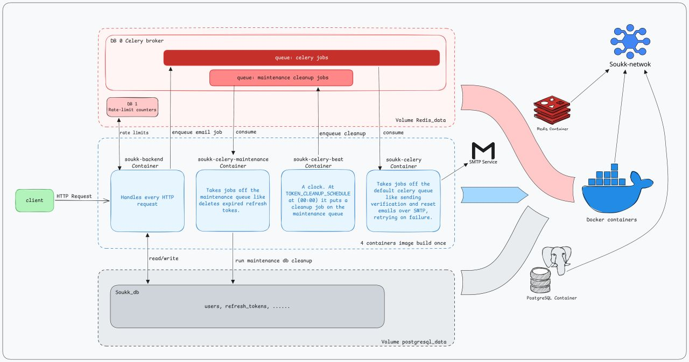

## Infrastructure

The stack runs as **6 containers** with Docker Compose. The API and all three background services are built from **one image** (`soukk-app:latest`) and each one starts with a different command.



### Services

| Container | Role | Postgres | Redis | Secrets it holds |
|---|---|---|---|---|
| `soukk-backend` | HTTP API (FastAPI / uvicorn). Pushes slow work onto a queue instead of doing it inline. | Read / write | DB 0 (enqueue), DB 1 (rate limits) | DB password, JWT secret |
| `soukk-celery` | Worker on the default `celery` queue. Sends emails over SMTP with retries. | None | DB 0 (consume) | Mail credentials only |
| `soukk-celery-maintenance` | Worker on the `maintenance` queue. Runs batched cleanup jobs. | Delete only | DB 0 (consume) | DB password only |
| `soukk-celery-beat` | Scheduler. Puts jobs on the `maintenance` queue on a cron schedule; never runs jobs itself. | None | DB 0 (enqueue) | None |
| `soukk-postgres` | `postgres:16`, data persisted on the `postgres_data` volume. Also hosts a separate test database. | — | — | DB credentials |
| `soukk-redis` | `redis:8.10.2` with `--appendonly yes`. Celery broker (DB 0) and rate-limit store (DB 1). | — | — | None |

### Design decisions

**Build once, run many.** The API and the three workers share a single image and differ only in their start command. Before this change, each service built its own image (~600 MB each, ~2.4 GB in total). Now one ~600 MB image is built once and reused, which also means a single build to wait for and a single artifact to version.

**Least-privilege configuration.** Everything lives in one shared `.env`, but each worker loads only what it needs through its own settings class (`EmailWorkerSettings`, `MaintenanceSettings`, `BeatSettings`):

- The email worker has mail credentials but **no database password and no JWT secret**.
- The maintenance worker has database access but **no mail credentials and no JWT secret**. It is the only worker that can reach Postgres.
- The scheduler has **no secrets at all**, only the Redis address and its cron schedule.

If any single worker is compromised, it can only reach what its job requires.

**Separate queues for separate workloads.** Email and maintenance jobs run on different queues with dedicated workers, so a backlog in one never blocks the other.

**Exactly one scheduler.** Workers can be scaled horizontally, but `celery-beat` must run as a single instance. A second instance would enqueue every scheduled job twice.

**Persistent state.** Postgres stores its data on a named volume, and Redis uses append-only persistence, so restarting containers doesn't lose data or queued jobs.

**Service discovery by name.** Containers reach each other by Compose service name on the internal network (the `DB_HOST` and `REDIS_HOST` values are overridden for containers), not `localhost`.

**Pinned versions.** Base images use fixed tags (`postgres:16`, `redis:8.10.2`) to avoid surprise upgrades.

### Running it

```bash
cp .env.example .env      # then fill in the values
docker compose up -d --build
docker compose ps
```

### Roadmap

- [ ] Trim the API container's environment to only the variables it uses (it currently receives the full `.env`)
- [ ] CI with GitHub Actions: run the tests, build the image, tag it with the commit hash and push it to a registry
- [ ] Deploy to a VPS behind Nginx with HTTPS
- [ ] Healthchecks and rollback by redeploying a previous image tag
- [ ] Monitoring and centralised logs